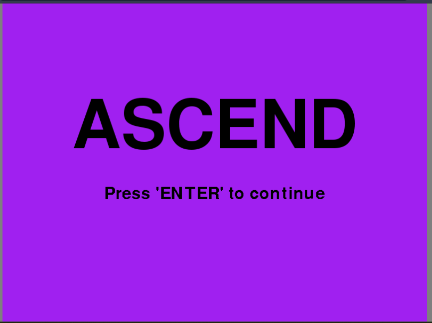
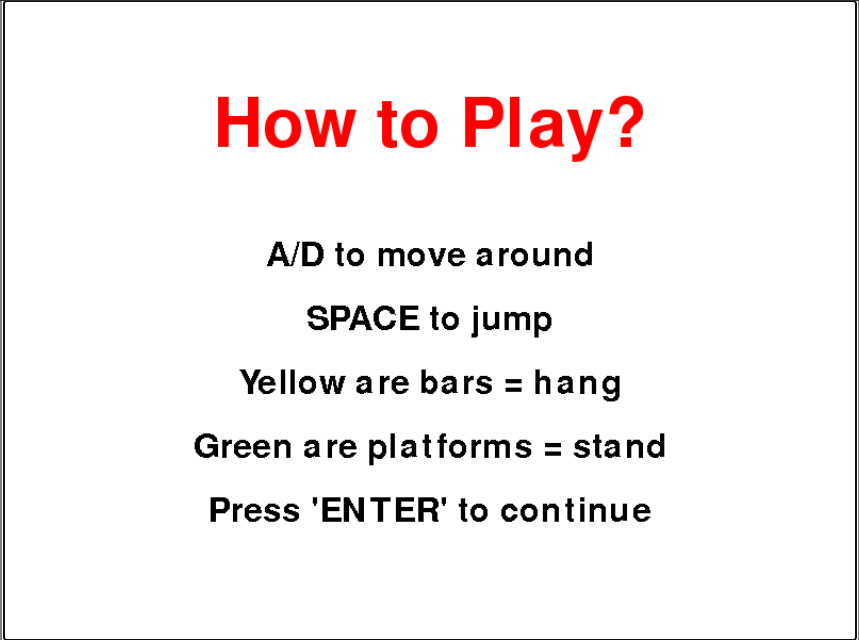
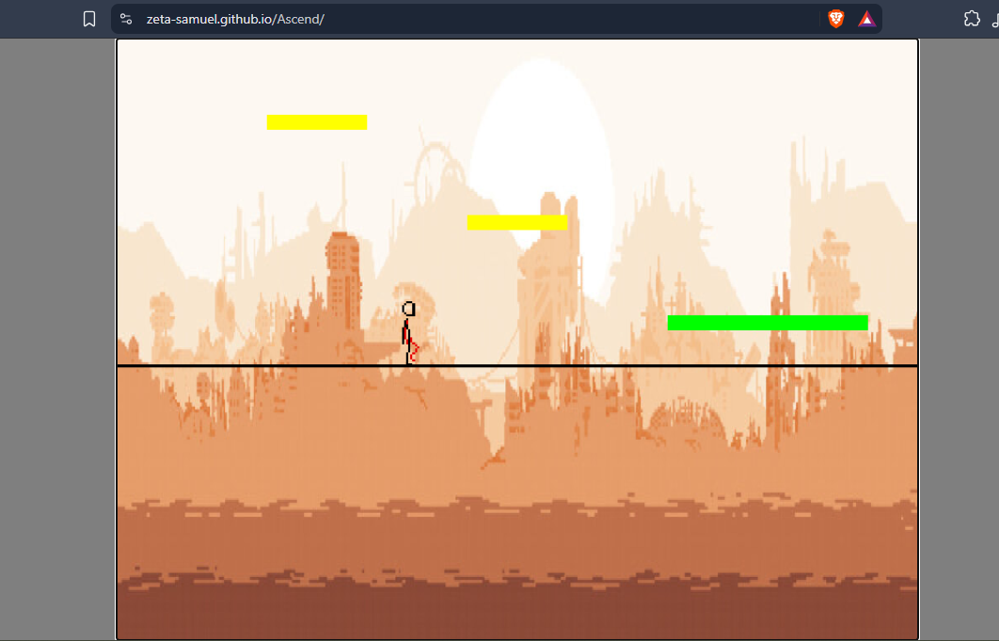

# Ascend

A game based around the theme of week 5 of Terra: 'RISE'

The main premice of the game is to climb the top of the platform and reach the end.
Though, there are no obstacles, maybe your skills will be tested (not to the fullest, I am not fond of such misery)

The game is easy to play and get used to. 

The game is made using pygame. If you like platformers you will love this style of game. 
It has a unique vibe to it. You can grab bars and walk on platforms and jump from one platform to another. 

Is this a new concept?
Ans: Maybe. Well you may find different game-play style of different games with a stick-man protagonist.

## How to try?

You know how you hate the: Download the game and test it, hope it's not a zip bomb or a virus.
Well, mine runs on the Webpage ( You are welcome :] )

## Demo
You can try the game at:
https://zeta-samuel.github.io/Ascend/

## Does the game work?
Here is the proof:




## Run in a browser

Install the dependencies and build/serve the project with Pygbag:

```powershell
python -m pip install -r requirements.txt
python -m pygbag .
```

Open the local URL printed by Pygbag (usually `http://localhost:8000`) in a
browser. Keep `main.py` and the `assets` folder inside this project directory
so the browser build can package the game images.

## How to play?

Press **Enter** to start. Use **A/D** to move and **Space** to release from a
bar or jump from the ground.
